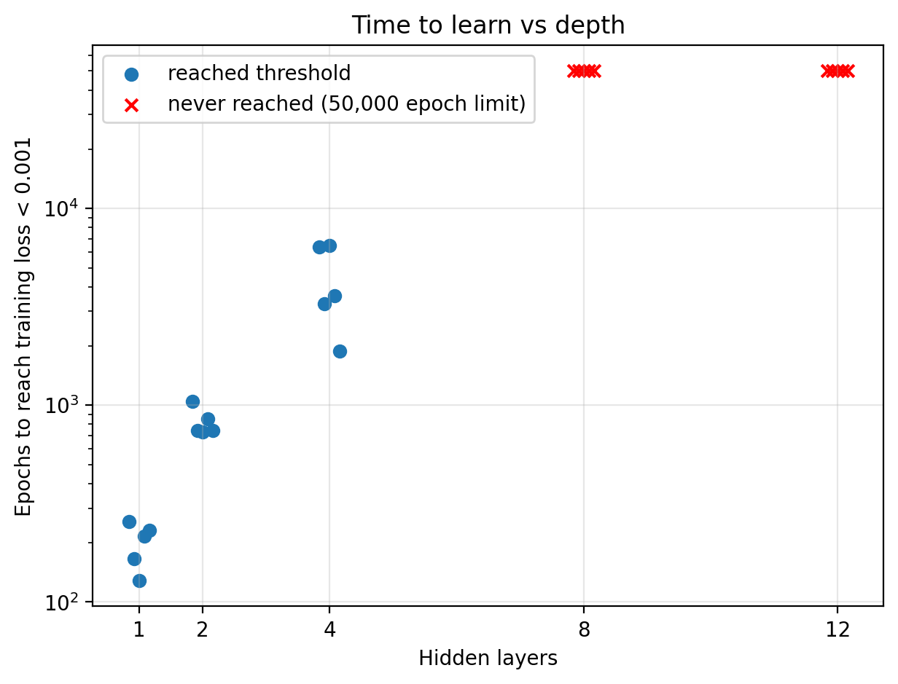
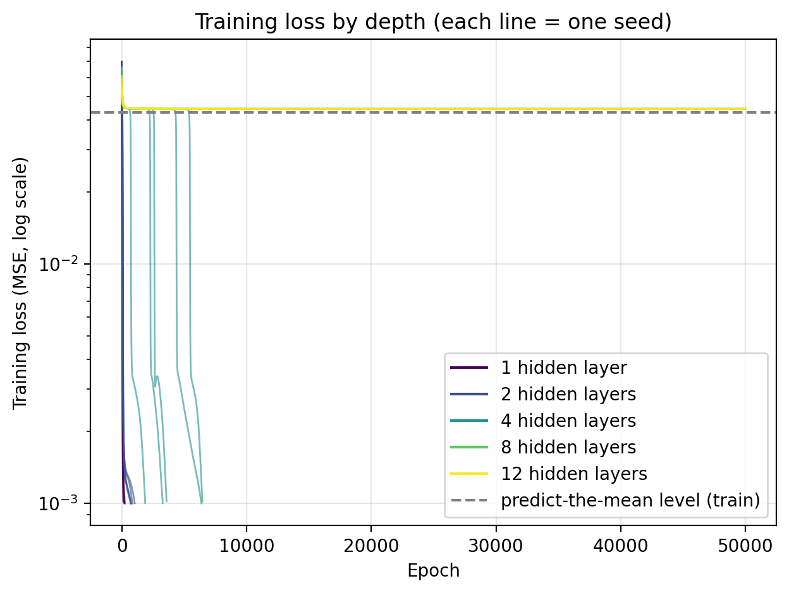
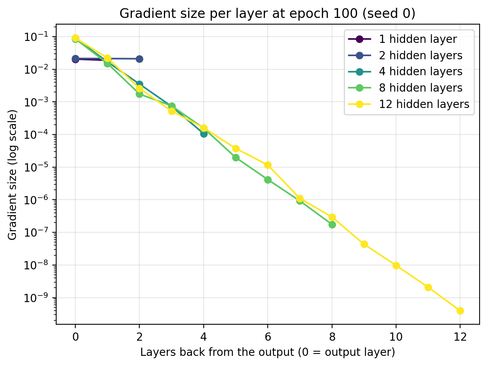
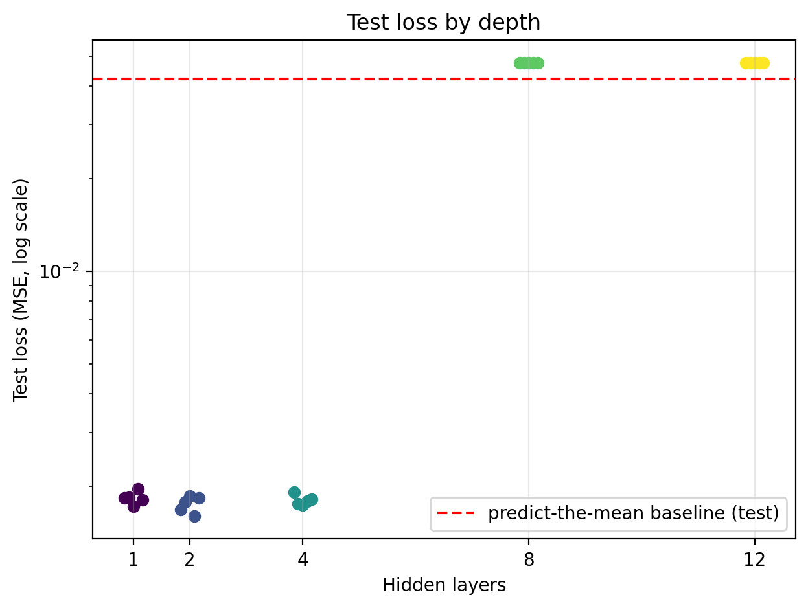

# Does depth hurt trainability? A from-scratch MLP experiment

A deep, narrow sigmoid network I trained sat on a flat loss plateau for ~43,000 epochs
before suddenly learning. This repo investigates why, using a small MLP written in pure
Python (no NumPy, no autograd).

## Motivation

In a single run, a 2-3-3-3-3-1 sigmoid net escaped its plateau late and then beat a
2-12-1 net on a held-out test set. One run can't separate architecture from
initialisation luck, so I ran a controlled sweep over depth with multiple seeds.

## Question

At fixed width, how does the number of hidden layers affect how quickly a sigmoid MLP
trains, and does depth change the final test error?

## Setup

- **Task:** regression on `f(x) = (x0*x1 + x0^3 + x1^3) / 3`, two inputs
- **Data:** 10 training points in [0.1, 0.9]^2; 200 random test points in [0, 1]^2
- **Networks:** width 4, depths 1, 2, 4, 8, 12 (17 to 237 parameters). Sigmoid
  activations throughout, including the output; weights initialised uniform(-1, 1)
- **Training:** per-sample SGD in a fixed order, learning rate 1, up to 50,000 epochs,
  stopping once training loss < 0.001
- **Seeds:** 5 per depth
- **Baseline:** predicting the training mean for every input (test MSE ≈ 0.042)

## Results

### Training time grows quickly with depth, then training fails



Depth 1 reached the threshold in about 130 to 260 epochs, depth 2 in about 740 to 1,040,
and depth 4 in about 1,900 to 6,400. All 5 seeds at depths 8 and 12 failed to reach it
within 50,000 epochs.

### Deeper nets sit on a plateau at the "predict the mean" level



Depth 4 runs show a plateau followed by a sudden drop, at a different epoch for each
seed. Depths 8 and 12 stay on the plateau for the whole run.

### Gradients shrink by roughly 5x per layer going backward



At depth 12, the gradient at the first layer is about 4 × 10^-10, roughly 2 × 10^8 times
smaller than at the output layer. This is consistent with vanishing gradients being why
the deep nets don't train. (Seed 0 only, at epoch 100.)

### Depth did not improve test error



The nets that trained (depths 1, 2, 4) reached similar test loss, more than 20x below
the baseline. Depths 8 and 12 ended at or slightly above the baseline.

## What this does and doesn't show

- The gradient plot shows tiny gradients where training fails. It does not prove they
  are the cause; I did not run a controlled test such as an initialisation or activation
  that keeps gradients stable at the same depth.
- "Never" means "not within 50,000 epochs".
- One toy function, 10 training points, one width, 5 seeds. Parameter count grows with
  depth, so the comparison across depths is not parameter-matched.
- The gradient figure uses a single seed at a single epoch.
- This sweep varies depth at width 4, so it does not directly re-test the original
  2-3-3-3-3-1 vs 2-12-1 comparison.

## Not resolved

As a follow-up I tried ReLU and leaky ReLU (He initialisation, linear output layer,
untuned learning rate). Shallow nets trained slowly and depth 12 still failed. Because
the learning rate wasn't tuned and I didn't identify why depth 12 failed, I draw no
conclusion from those runs. The code supports `--activation relu` and `leaky_relu` for
anyone who wants to pick this up.

## Reproduce

```
pip install matplotlib
python mlp.py                                  # about 10 to 15 minutes, writes results/
python plot.py results/sigmoid_lr1.0.json      # writes figures/
```

## Files

- `mlp.py`: the MLP, training loop and experiment runner
- `plot.py`: makes the four figures from a results file
- `results/`: raw results (JSON)
- `figures/`: generated figures
